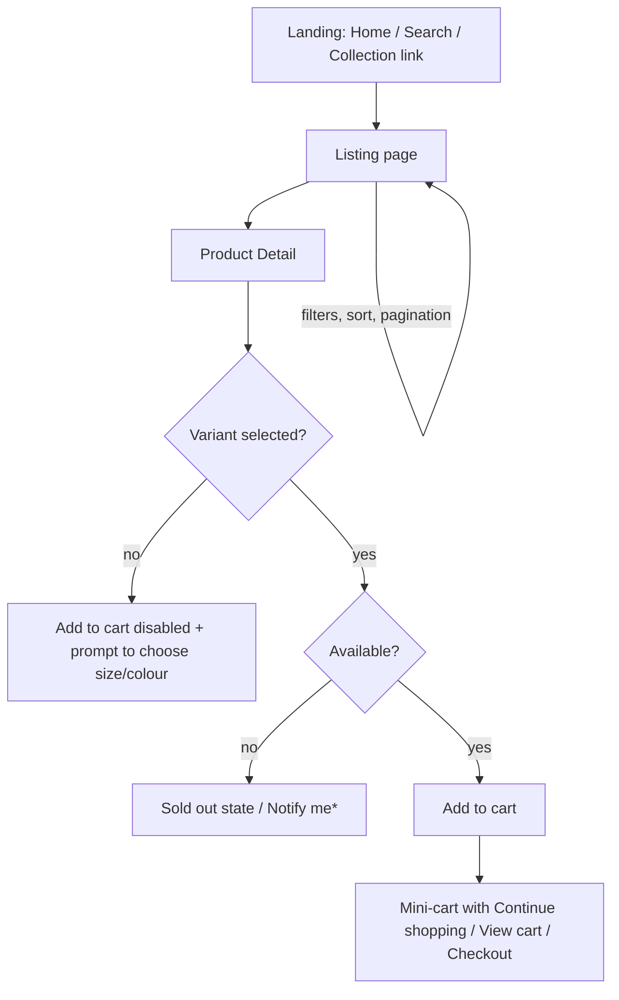
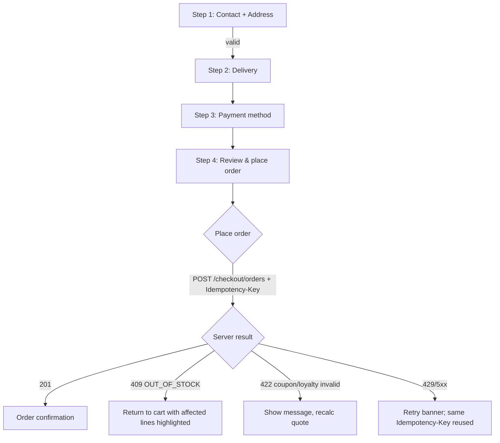
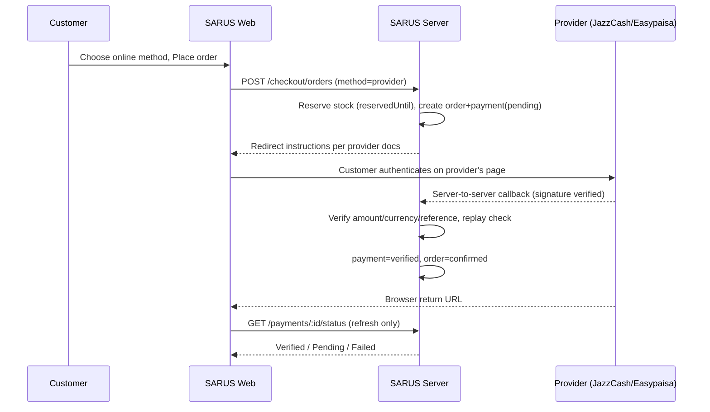
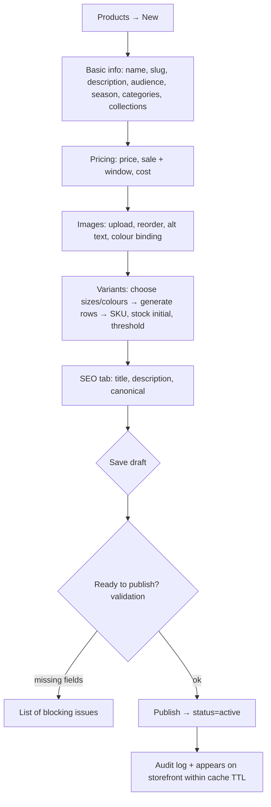
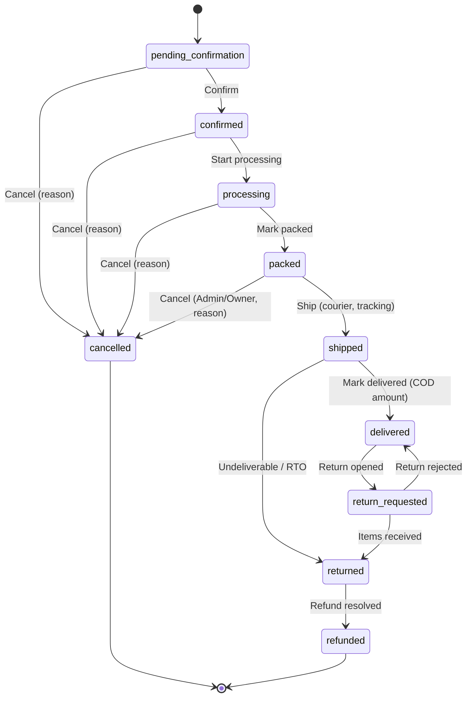

# SARUS Clothes — App Flow (User and Admin Experience)

| Field | Value |
|---|---|
| Project | **SARUS Clothes** |
| Version / Status | 1.0 · Draft |
| Date | 29 October 2026 |
| Related | PRD.md (§6, §7, §12, §26), UI_UX_DESIGN_BRIEF.md, BACKEND_SCHEMA.md |

Purpose: describe, screen by screen and step by step, how customers and staff move through SARUS Clothes, including decision points, system responses and error/empty states. Flows reference PRD requirement and story IDs. "Server" means the Node API; any value shown (price, stock, status) comes from the server.

---

## 1. Screen Inventory

### 1.1 Storefront
| Screen | Route | Auth | Indexed |
|---|---|---|---|
| Home | `/` | none | yes |
| Shop / Audience / Category | `/shop`, `/shop/:audience`, `/category/:slug` | none | yes (filters canonicalised) |
| Collections index / detail | `/collections`, `/collections/:slug` | none | yes |
| Product detail | `/product/:slug` | none | yes |
| Search results | `/search?q=` | none | no |
| Cart | `/cart` | none | no |
| Checkout (4 steps) | `/checkout` | none (guest) or customer | no |
| Order confirmation | `/order/confirmation/:orderNo` | order owner or guest session proof | no |
| Track order | `/track-order` | none (matching details) | no |
| CMS & policy pages | `/pages/:slug`, `/policies/:slug` | none | yes |
| Support | `/support` | none | yes |
| 404 / 410 / maintenance | — | — | no |

### 1.2 Customer account
Login, Sign up, Verify email, Forgot/Reset password, Account overview, Profile, Addresses, Orders list, Order detail, Returns list, New return, Wishlist, Loyalty, Privacy & data.

### 1.3 Admin
Login, Dashboard, Products (list/editor/variants/SEO), Categories, Collections, Inventory (stock, movements, import), Orders (list/detail), Shipments, Returns, Refunds, Customers (list/detail), Coupons, Loyalty, Reviews, Content (homepage, banners, pages), SEO, Notifications, Reports, Settings (store, shipping, payments status, analytics, returns, loyalty), Staff, Audit logs.

---

## 2. Global Behaviours

| Behaviour | Rule |
|---|---|
| Header | Sticky; shows Cart count from server cart; Wishlist/Account entry; announcement bar above |
| Cookie/consent banner | First visit; analytics/marketing scripts load only after consent; essential cookies (cart, session) do not require consent |
| Currency & time | `Rs 1,500` PKR; dates in Asia/Karachi |
| Error surfaces | Inline field error → toast for transient → full-page error with request ID for fatal; never raw stack traces |
| Loading | Skeletons for lists/PDP; button spinners for actions; no layout shift |
| Offline/slow | Retry banner; actions disabled while pending to avoid duplicates (server idempotency is the real guard) |
| Maintenance mode | Storefront shows maintenance page (HTTP 503); admin still reachable by Owner/Admin |

---

## 3. Customer Flows

### 3.1 Discover → Product Detail

*Notify me is optional (Could Have).

**Steps and system responses**
1. User opens Home → CMS blocks load (announcement, hero, season spotlight, category tiles, featured). Empty block (no featured products) is omitted, not shown blank.
2. User taps *Winter* in nav → `/collections/winter`: banner, description, products. If the collection is `scheduled` and not yet live → 404; if `expired` → page with "This collection has ended" and link to Shop.
3. Listing: filters in a side panel (desktop) / bottom sheet (mobile); URL query updates; count "Showing 24 of N". No results → empty state with Clear filters + popular categories.
4. PDP: gallery, price (with struck price/discount if sale is active **now** per server), size/colour selectors, stock status badge ("In stock", "Only few left" when ≤ low threshold, "Sold out"), size guide, fabric/fit/care accordion, delivery estimate (city select), return policy summary, related products.
5. Add to cart: `POST /cart/items`. Success → mini-cart; `409 OUT_OF_STOCK` → inline message "Only N available" and selector refreshes.

### 3.2 Search
Type in header search → suggestions (`GET /search/suggest`) after 2 chars (debounced 250 ms) → Enter → `/search?q=`. Empty/symbol-only → popular categories. No result → suggestions + contact link.

### 3.3 Cart
```mermaid
flowchart TD
  A[Open cart] --> B[GET /cart recomputes lines]
  B --> C{Any warnings?}
  C -- price changed --> D[Show 'Price updated' chip on line]
  C -- out of stock/inactive --> E[Line flagged, excluded from totals, Remove / Move to wishlist]
  C -- none --> F[Show summary: items, discounts, estimated shipping (needs city)]
  F --> G[Apply coupon (optional)]
  F --> H[Proceed to checkout]
  H --> I{Any blocking line?}
  I -- yes --> J[Block with explanation]
  I -- no --> K[Checkout step 1]
```
Quantity stepper calls `PATCH /cart/items/:variantId`; max = available (server). Remove → `DELETE`. Empty cart → empty state.

### 3.4 Checkout (guest or registered, COD)

**Step 1 — Contact & address.** Guest: name, phone, optional email. Registered: pick saved address or add new. Validation (UX hints; server authoritative): phone `03XXXXXXXXX`/`+923XXXXXXXXX` normalised; city from list (autocomplete); address min length; instructions ≤ 300 chars. Unknown city → "We don't deliver to this city yet".
**Step 2 — Delivery.** Server returns shipping fee and ETA range for the city's zone; free-shipping progress bar appears only if a threshold is configured.
**Step 3 — Payment.** Only enabled methods listed. 1.0: **Cash on Delivery**. JazzCash/Easypaisa are hidden (or shown disabled "Coming soon" if the owner chooses; never selectable while `Not Configured`). COD note about collecting exact amount.
**Step 4 — Review.** Items, coupon field, loyalty redeem control (registered + verified + balance ≥ minimum), totals from `POST /checkout/quote`. Terms/privacy acknowledgement. Place order button disabled during request.
**On success.** Confirmation page: order number, summary, expected next steps ("We'll confirm by phone/message"), Track order link, optional "Create account" for guests (email must be provided; account linking only after verification). Cart cleared. Email requested via outbox; page text avoids "email sent" claims unless confirmed.
**Registered but unverified email.** Step 1 shows banner "Verify your email to place orders" with resend link; place order blocked server-side.

### 3.5 Online payment flow (post-activation reference; **not active in 1.0**)

Browser return never changes payment state. If the callback is late, UI shows "Payment pending" and refresh polling; unresolved after reservation expiry → order expires and stock is released; late success goes to staff `review_required`.

### 3.6 Registration, login and verification
1. Sign up: email, password, name, consent checkboxes (marketing unticked). → Firebase creates user → server `session/sync` creates `users/{uid}` → verification email requested.
2. Verify screen: instructions; resend (rate-limited); after clicking email link user returns to `/auth/verify-email` → status refresh.
3. Login: email/password (+Google optional). Wrong credentials → generic message. After login: guest cart merged (`POST /cart/merge`), redirect to return URL.
4. Forgot password: always shows "If an account exists, we've sent an email" (no enumeration).
5. Logout: Firebase sign out + server cart cookie retained only for guest cart (new anonymous cart).

### 3.7 Account area
- **Overview:** recent orders, loyalty balance, wishlist count.
- **Orders:** list (status chips, total, date), detail (timeline from events visible to customer, items from snapshots, shipping address, payment status, tracking ref, actions: Cancel (if allowed), Request return (if eligible), Reorder → adds available variants to cart).
- **Addresses:** CRUD, default; max 10.
- **Privacy:** export request, deletion request, marketing consent toggle (logs consent change), consent history.

### 3.8 Order tracking (guest/member)
`/track-order` → order number + phone or email → `POST /track-order` → limited view: status, timeline (only recorded events), courier + tracking reference (if staff entered), items count. Failure → generic "We couldn't find that order" (no hints). After 5 attempts/min → 429 message.

### 3.9 Cancel flow
Order detail → Cancel (visible only when status `pending_confirmation`) → confirm dialog with reason → `POST /orders/:no/cancel-request` → status `cancelled` immediately for self-serve; otherwise message "Request received" and staff handle it. Shipped → button hidden; help text explains refusal/return.

### 3.10 Return / exchange flow
```mermaid
flowchart TD
  A[Order delivered] --> B{Within window & eligible?}
  B -- no --> C[Show reason + Contact support]
  B -- yes --> D[Select items, quantity, reason, photos optional]
  D --> E{Resolution wanted}
  E -- Refund --> F[Submit]
  E -- Exchange --> G[Select new size/colour (server checks availability)]
  G -->|unavailable| H[Offer refund instead]
  G -->|available| F
  F --> I[Status: requested]
  I --> J[Staff decision: approved / rejected]
  J -->|approved| K[Customer ships/hands over or pickup arranged]
  K --> L[Received + inspected]
  L --> M[Resolved: refund / exchange order]
```
Customer sees return status chips and messages at each step; refund shows "Refund pending/approved/completed" separately from the order status.

### 3.11 Wishlist
Heart on card/PDP: guest → login modal (with return); registered → `PUT /wishlist/items/:productId`. Wishlist page: grid with availability state; "Move to cart" (requires variant choice if product has several); remove.

### 3.12 Loyalty
Loyalty page: available / pending / expiring soon, rules summary (points per PKR, minimum redemption, cap), ledger table (earn, redeem, expire, adjust with reason). No edit controls. At checkout: slider or input respecting limits; server revalidates.

### 3.13 Reviews
After delivery, account order detail shows "Write a review" per item → pending moderation message. Product pages display only approved reviews; aggregates and schema appear only when real reviews exist.

---

## 4. Admin Flows

### 4.1 Admin sign-in
1. `/admin` → Firebase login (+MFA if enabled) → server `GET /me` returns `staff` role.
2. Non-staff user → "You don't have access" (403), no staff data leaked.
3. Sidebar items are filtered by role permissions; deep links are re-checked server-side.
4. Idle timeout (configurable [TBD]) → re-authenticate.

### 4.2 Create and publish a product

Initial stock entered in the variant grid is recorded as `restock` movements (not a silent field edit). Editing stock later happens only in Inventory → Adjust.

### 4.3 Inventory adjust and history
Inventory list (filter low/out of stock, season, category) → row **Adjust** → choose type (Restock, Correction, Damage write-off), quantity, reason → preview "On hand 10 → 25; Reserved 3; Available 22" → confirm → movement created. Rejected if result < reserved or < 0. History tab shows immutable movements with actor and reference.

### 4.4 CSV import
Upload CSV → server parses → **Preview**: counts (create/update/invalid), table of errors by row/column → fix file and re-upload, or **Confirm import** → progress with job status → result report (downloadable). No change is made before confirmation; import is idempotent.

### 4.5 Seasonal collection management
Collections → New → type (Summer/Winter/All-Season/Campaign), banners (desktop/mobile + alt), description, featured products, schedule (`publishAt`, `expireAt`, shown in PKT), SEO → Save as Draft / Schedule / Publish. Archive action explains that products and order history remain intact. Products can also be attached/detached to collections from the product editor.

### 4.6 Order fulfilment

**Order detail layout:** header (order no., status chip, payment chip, placed time PKT), customer + address (masked phone for roles without need), items (snapshots), totals, shipment panel, timeline, internal notes, action bar showing **only allowed actions** for the current status and the staff member's role. Actions open confirmation dialogs; Ship requires courier and (if available) tracking number; Cancel requires reason; failed transition shows server message.
**Concurrency:** if another staff member changed the order, the action returns a conflict and the page reloads with the latest state.

### 4.7 Shipments and failed delivery
Shipments list (filters by status, courier). On a shipped order: log attempt (date, outcome, reason). Outcomes: Delivered, Failed (reason + next action), Return to sender. Tracking page for customers mirrors only entered events.

### 4.8 Returns and refunds
Returns queue → open return → view items/photos/reason → **Approve** / **Reject** (reason) → on item arrival **Receive & inspect** (per item: resellable / damaged / not received) → system creates restock movements for resellable → choose resolution: Refund / Exchange / Reject. **Refund**: create refund record (amount ≤ remaining) → Admin/Owner **Approve** → **Complete** requires provider confirmation reference or documented manual resolution (method, reference, approver, note). Order becomes `refunded` only after all refund items resolved.

### 4.9 Coupons and promotions
Create coupon: type, value, caps, min spend, dates, usage limits, eligibility lists, stackable flag → Save as Draft/Active. Usage tab shows redemption records. Validation errors shown per field; duplicate code blocked.

### 4.10 Loyalty administration
Settings (earn rate, point value, min redemption, cap, expiry, return-window release) → Save (audit). Customer detail → Adjust points (delta, reason required) → ledger row. Ledger view with filters (customer, type, date).

### 4.11 Content management
Homepage editor: ordered blocks (announcement, hero, season spotlight, category tiles, product rails, promo strip, newsletter) with preview; banners with schedule; CMS pages (About, FAQ, Size Guide, policies) with sanitised rich text and SEO fields; publish/draft/archive.

### 4.12 Staff and security
Staff list → Invite (email, role) → invitee receives Firebase-based sign-in email → role active on first login after acceptance. Change role → sessions revoked. Disable → sessions revoked. Audit logs viewer with filters (actor, entity, action, date) and diff view. Payment integration screen: status chips; Owner-only changes; no secret display.

### 4.13 Dashboard and reports
Date range picker (PKT), season/collection/audience filters → KPI cards (net sales, orders, AOV, cancellation rate, refunds), charts, top products, low stock list, seasonal comparison. Empty data → "No data for this period". Profit section shows cost-missing warnings. Export CSV (permission-gated, masked PII, audit-logged).

---

## 5. Notifications Flow (customer-visible)
Event → outbox → provider (if configured) → customer receives message. In-app order timeline is the source of truth; email/SMS are supplementary. If no provider is configured, no message is sent and the UI does not claim otherwise. Marketing opt-in/out managed in Privacy settings; unsubscribe link in marketing messages.

---

## 6. Error, Empty and Edge-State Catalogue

| Situation | Customer sees | Staff sees |
|---|---|---|
| Out of stock at checkout | Line highlighted, "Only N left" / "Sold out", cart editable | Order not created; no movement |
| Price changed during checkout | Notice with new total; must re-confirm | — |
| Coupon invalid/expired | Specific message (expired, min spend, not eligible) or generic "Invalid code" | Redemption report |
| Network failure on place order | Retry button reuses same Idempotency-Key | Single order only |
| Session expired | Redirect to login with return URL; cart persists | Re-auth modal |
| Product removed while in cart | Line flagged, excluded | — |
| Unknown city | "We don't deliver to this city yet" | Zone settings |
| 403 | "You don't have access to this page" | Role matrix reference |
| 404/410 | Branded not found/gone page | — |
| Invalid state transition | — | Conflict message with current status |
| Concurrent edit | — | "This record changed; reload" |
| Missing integration | "Not available" / feature hidden | `Not Configured` badge with setup guide link |
| No data (analytics/lists) | — | "No data for this period / No records" |

---

## 7. Flow-to-Requirement Map
| Flow | PRD refs | Stories |
|---|---|---|
| Discover/PDP | FR-001–012 | US-001–003 |
| Cart | FR-040–044 | US-004, US-007 |
| Checkout COD | FR-045–055 | US-008, US-011 |
| Account | FR-031–036 | US-005, US-006, US-017 |
| Tracking | FR-054 | US-012 |
| Cancel | §12.2 | US-013 |
| Returns | FR-068–073 | US-014, US-109, US-110 |
| Wishlist | FR-037–039 | US-015 |
| Loyalty | FR-080–086 | US-009, US-016, US-112 |
| Admin product/inventory | FR-019–030 | US-102–104 |
| Collections | FR-013–018 | US-105 |
| Fulfilment | FR-063–067 | US-106–108 |
| Coupons | FR-074–079 | US-010, US-111 |
| Content/SEO | FR-107–112 | US-113 |
| Staff/audit | FR-087–095 | US-101, US-114, US-116 |
| Analytics | FR-096–101 | US-115 |

*End of App Flow.*
