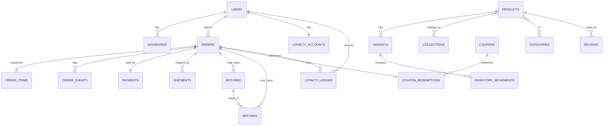

# SARUS Clothes — Backend Schema (Cloud Firestore)

| Field | Value |
|---|---|
| Project | **SARUS Clothes** |
| Version / Status | 1.0 · Draft |
| Date | 29 October 2026 |
| Related | PRD.md §22–23, TRD.md §5–6 |
| Normative for | Collections, fields, enums, invariants, rules strategy, indexes, transaction recipes |

> This schema has not been deployed or load-tested. Firestore limits (document size 1 MiB, write rates, transaction limits, index limits) must be re-verified against current documentation **[VERIFY]**.

---

## 1. Conventions

| Topic | Rule |
|---|---|
| Ids | Firestore auto-ids unless stated. Deterministic ids used for idempotency (movements, ledger, redemptions, events). |
| Timestamps | Firestore `Timestamp` (UTC). Display in Asia/Karachi. |
| Money | `number` integer PKR (whole rupees). Never floats. Field names end with `Amount`/`Price`/`Total` or are documented as money. |
| Common fields | `createdAt`, `updatedAt` (server timestamps), `schemaVersion` (int), mutable docs also `version` (int, increment on every write) |
| Soft delete | `status: 'archived'` or `deletedAt`; hard delete only for non-referenced, non-financial data |
| Enums | Lower_snake_case strings; defined in §3 and mirrored in `packages/shared` |
| Phone | E.164 string `+923XXXXXXXXX` |
| Slugs | lowercase `a-z0-9-`, unique per collection (registry or query-in-transaction) |
| Actor object | `{ type: 'customer'|'staff'|'system', uid?: string, role?: string, name?: string }` |
| Optional | Marked `?`; all other fields required |
| Authoritative vs derived | **A** = authoritative; **D** = derived/cache (rebuildable) |
| Writers | "Server" = Node API/Jobs via Admin SDK. Clients never write directly. |

---

## 2. Collection Map

```
users/{uid}
  └ addresses/{addressId}
staff/{uid}
products/{productId}
  └ variants/{variantId}
skuRegistry/{sku}
slugRegistry/{type__slug}
categories/{categoryId}
collections/{collectionId}
optionSets/{optionSetId}
inventoryMovements/{movementId}
carts/{cartId}
wishlists/{uid}
  └ items/{itemId}
orders/{orderId}
  ├ items/{itemId}
  └ events/{eventId}
payments/{paymentId}
paymentEvents/{eventKey}
shipments/{shipmentId}
returns/{returnId}
refunds/{refundId}
coupons/{couponId}
couponCodes/{CODE}
couponRedemptions/{orderId__couponId}
loyaltyAccounts/{uid}
loyaltyLedger/{entryId}
reviews/{reviewId}
settings/{docId}               # store, shipping, returns, loyalty, payments, analytics, seo, notifications, public
banners/{bannerId}
pages/{slug}
homepage/main
redirects/{redirectId}
notificationTemplates/{templateId}
notificationOutbox/{messageId}
supportNotes/{noteId}
expenses/{expenseId}
analyticsDaily/{yyyymmdd}
importJobs/{jobId}
reportJobs/{jobId}
dataRequests/{requestId}
idempotencyKeys/{keyHash}
auditLogs/{logId}
counters/{counterId}
```

---

## 3. Enumerations

| Enum | Values |
|---|---|
| `Role` | `owner, admin, product_manager, order_manager, content_editor, support, analyst` |
| `Audience` | `men, women, kids, unisex` |
| `Season` | `summer, winter, all_season` |
| `ProductStatus` | `draft, active, inactive, archived` |
| `VariantStatus` | `active, inactive, archived` |
| `CollectionType` | `summer, winter, all_season, campaign` |
| `CollectionStatus` | `draft, scheduled, published, expired, archived` |
| `OrderStatus` | `pending_confirmation, confirmed, processing, packed, shipped, delivered, cancelled, return_requested, returned, refunded` |
| `PaymentMethod` | `cod, jazzcash, easypaisa` |
| `PaymentStatus` | `initiated, pending, verified, failed, expired, cod_awaiting, cod_collected, void, review_required` |
| `ShipmentStatus` | `created, dispatched, in_transit, delivered, failed_delivery, returned_to_sender` |
| `ShipmentDirection` | `outbound, return` |
| `ReturnStatus` | `requested, approved, rejected, in_transit, received, inspected, resolved, cancelled` |
| `ReturnResolution` | `refund, exchange, store_credit, rejected` |
| `InspectionOutcome` | `resellable, damaged, not_received` |
| `RefundStatus` | `pending, approved, processing, completed, failed, rejected` |
| `MovementType` | `restock, correction, reservation, reservation_release, fulfilment, return_restock, cancellation_release, import_adjustment, damage_writeoff` |
| `CouponType` | `percentage, fixed_amount, free_shipping, bundle` |
| `CouponStatus` | `draft, active, paused, expired, archived` |
| `LoyaltyEntryType` | `earn_pending, earn_available, redeem, redeem_reversal, earn_reversal, expire, manual_adjust` |
| `ReviewStatus` | `pending, approved, rejected` |
| `NotificationStatus` | `queued, sending, sent, delivered, bounced, failed, not_configured, cancelled` |
| `ProviderStatus` | `not_configured, sandbox, live, error` |
| `DataRequestType` / Status | `export, delete` / `received, in_progress, completed, rejected` |

---

## 4. Collection Specifications

For each collection: purpose, fields, relationships, access (R/W), validation, indexes, lifecycle. Access shorthand: **Pub** public via API; **Own** owner customer; **Staff:x** specific staff roles; **Server** only server.

### 4.1 `users/{uid}` — customer profile (A)
| Field | Type | Req | Notes |
|---|---|---|---|
| uid | string | ✔ | = Firebase uid (doc id) |
| email | string | ✔ | lowercase |
| emailVerified | boolean | ✔ | synced from Auth on session sync |
| displayName | string | ✔ | 1–80 chars |
| phone | string | | E.164 PK |
| marketingConsent | map{status:boolean, updatedAt, source, textVersion} | ✔ | default false |
| defaultAddressId | string | | ref `users/{uid}/addresses` |
| locale | string | | default `en` |
| status | `active|disabled|deleted` | ✔ | |
| lastLoginAt | Timestamp | | |
| createdAt, updatedAt, schemaVersion | | ✔ | |
**Access:** Own read; Server write. Staff read via admin API (Staff: owner, admin, support, order_manager; analyst masked). **No role fields here.**
**Validation:** phone regex; displayName sanitised. **Indexes:** email (single). **Lifecycle:** on deletion, anonymise (`status=deleted`, remove PII), keep id for order linkage.

### 4.2 `users/{uid}/addresses/{addressId}` (A)
`fullName`✔, `phone`✔ (E.164), `province`✔, `city`✔ (must exist in shipping city list), `area`, `line1`✔ (5–200), `line2`, `postalCode`, `instructions` (≤300), `isDefault` bool, `label` (Home/Work/Other). Max 10 per user (server enforced in transaction). Access: Own read; Server write. Deleted with user.

### 4.3 `staff/{uid}` (A)
`uid`✔, `email`✔, `displayName`, `role`✔ (`Role`), `status`✔ (`active|disabled|invited`), `invitedBy`, `invitedAt`, `lastLoginAt`, `mfaEnrolled` bool (D, from Auth), plus common fields. Access: Staff:owner/admin read; Server write (Owner-controlled). Invariant: ≥ 1 `active` owner (checked in transaction using `counters/activeOwners`). Indexes: `status+role`.

### 4.4 `products/{productId}` (A; `ratingSummary`, `searchTokens`, `variantSummary` = D)
| Field | Type | Req | Notes |
|---|---|---|---|
| name | string | ✔ | 2–140 |
| slug | string | ✔ | unique (via `slugRegistry/product__{slug}`) |
| productSku | string | ✔ | unique (via `skuRegistry`) |
| description | string (sanitised HTML/markdown) | | ≤ 10 000 chars |
| audience | `Audience` | ✔ | |
| season | `Season` | ✔ | |
| categoryIds | string[] | ✔ | ≥ 1, ≤ 5 |
| collectionIds | string[] | | ≤ 20; membership source of truth |
| tags | string[] | | ≤ 20, lowercase |
| fabric, fit | string | | |
| careInstructions | string[] | | |
| images | array<{id, storagePath, url, alt, colorValue?, sortRank, width, height}> | ✔ (≥1 to publish) | alt required to publish |
| price | int | ✔ | selling price ≥ 0 |
| salePrice | int | | < price |
| saleStartAt, saleEndAt | Timestamp | | `start < end`; sale active iff now in window |
| costPrice | int | | **never exposed publicly** |
| sizeGuideId | string | | ref `pages` |
| seo | map{title, description, canonicalUrl?, ogImage?, noindex?} | | |
| status | `ProductStatus` | ✔ | |
| publishedAt | Timestamp | | |
| ratingSummary | map{count, average} | D | from approved reviews |
| variantSummary | map{minPrice, maxPrice, inStockCount, totalAvailable} | D | recomputed on stock/price change; used for listing sort/filter |
| searchTokens | string[] | D | |
| createdBy/updatedBy | actor | ✔ | |
**Access:** public read via API only when `status=active` (cost/stock fields stripped); Staff read all per role; Server write. **Validation:** per PRD §9. **Indexes:** see §6. **Lifecycle:** archive only; products referenced by orders cannot be deleted.

### 4.5 `products/{productId}/variants/{variantId}` (A)
| Field | Type | Req | Notes |
|---|---|---|---|
| sku | string | ✔ | unique via `skuRegistry` |
| barcode | string | | |
| size | string | ✔ | value from `optionSets` |
| color | map{name, hex?} | ✔ | |
| status | `VariantStatus` | ✔ | |
| priceOverride | int | | |
| costOverride | int | | |
| stockOnHand | int | ✔ | ≥ 0 |
| stockReserved | int | ✔ | ≥ 0, ≤ stockOnHand |
| lowStockThreshold | int | ✔ | ≥ 0 (default from `settings/store`) |
| lowStockFlag | boolean | D | maintained by inventory service |
| productId | string | ✔ | denormalised for collection-group queries |
| createdAt, updatedAt, version | | ✔ | |
**Derived:** `available = stockOnHand − stockReserved`. **Access:** Server write only; client never reads (public API exposes `in_stock | low | out` unless `settings/store.showExactStock=true`). **Indexes:** collection-group `variants`: `sku` (unique via registry), `productId+status`. **Lifecycle:** archive; never delete if referenced.

### 4.6 `skuRegistry/{sku}` and `slugRegistry/{type__slug}` (A)
`entityType`, `productId?`, `variantId?`, `createdAt`. Created via `transaction.create()` in the same transaction as the product/variant to guarantee uniqueness. Server only.

### 4.7 `categories/{categoryId}` (A)
`name`✔, `slug`✔, `parentId?`, `audienceHint?`, `description`, `image{url,alt}`, `sortRank`✔ (int), `status`✔ (`active|inactive|archived`), `seo{}`. Pub read (active); Server write (Staff:product_manager+). Index: `status+parentId+sortRank`. Max depth 3.

### 4.8 `collections/{collectionId}` (A)
`name`✔, `slug`✔, `type`✔, `description`, `bannerDesktop{url,alt}`, `bannerMobile{url,alt}`, `status`✔, `publishAt?`, `expireAt?`, `featuredProductIds[]` (≤ 24, ordered), `sortRank`✔, `showWhenExpired` bool (default true), `promotionId?`, `seo{}`, `productCount` (D). Invariants: `publishAt < expireAt`; `archived` never hard-deleted; products' `collectionIds` untouched on archive. Pub read (published/expired as configured); Server write (Staff:product_manager/content_editor/admin/owner). Indexes: `status+type+sortRank`, `status+publishAt`, `status+expireAt`.

### 4.9 `optionSets/{id}` (A)
`kind` (`size|color`), `name` (e.g., "Men tops", "Kids age"), `values[]` (size: label + sortRank; color: name + hex), `audience?`. Pub read; Server write.

### 4.10 `inventoryMovements/{movementId}` (A, immutable)
| Field | Type | Notes |
|---|---|---|
| variantId, productId, sku | string | ✔ |
| type | `MovementType` | ✔ |
| deltaOnHand | int | signed |
| deltaReserved | int | signed |
| before | {onHand, reserved} | ✔ |
| after | {onHand, reserved} | ✔ |
| reason | string | required for correction/writeoff/restock |
| refs | {orderId?, returnId?, importJobId?} | |
| actor | actor | ✔ |
| idempotencyKey | string | ✔ |
| createdAt | Timestamp | ✔ |
**Id:** `{type}_{orderId|returnId|importJobId|adjustId}_{variantId}`. Written via `transaction.create` (fails if exists ⇒ idempotent). **Access:** Staff read (product_manager, order_manager, admin, owner, analyst, support read-only); Server create only; no update/delete. Indexes: `variantId+createdAt desc`, `refs.orderId+createdAt`, `type+createdAt`. Retention ≥ 7 years [TBD].

### 4.11 `carts/{cartId}` (A for lines; prices are never stored as authority)
`ownerType` (`guest|user`), `uid?`, `lines[{variantId, qty, addedAt}]` (≤ 50), `couponCode?` (candidate only), `expiresAt` (TTL: guests 30 d from last update), `mergedInto?`. Access: Server only (clients via API with cookie/token). TTL policy on `expiresAt`. Index: `uid`.

### 4.12 `wishlists/{uid}/items/{itemId}` (A)
`productId`✔, `variantId?`, `addedAt`. `itemId = productId` or `productId__variantId`. Own read via API; Server write.

### 4.13 `orders/{orderId}` (A; `paymentStatus` mirror = D)
| Field | Type | Req | Notes |
|---|---|---|---|
| orderNumber | string | ✔ | e.g. `SC-20261029-7K3QX9` (date PKT + random base32; unique via registry doc `counters`/`orderNumbers`) |
| status | `OrderStatus` | ✔ | |
| version | int | ✔ | |
| userId | string | | null for guests |
| customer | {name, phone, email?} | ✔ | snapshot at order time |
| shippingAddress | map{fullName, phone, province, city, area?, line1, line2?, postalCode?, instructions?} | ✔ | snapshot |
| zoneId | string | ✔ | |
| totals | map{merchandiseGross, promotionDiscount, couponDiscount, loyaltyRedeem, merchandiseNet, shipping, codFee, total} | ✔ | ints |
| currency | `'PKR'` | ✔ | |
| paymentMethod | `PaymentMethod` | ✔ | |
| paymentId | string | ✔ | ref `payments` |
| paymentStatus | `PaymentStatus` | D | mirror of payment for querying |
| couponCode | string | | |
| couponId | string | | |
| loyaltyPointsRedeemed | int | | |
| loyaltyPointsEarnPlanned | int | | computed at placement for display |
| pricingVersion, pricingHash | string | ✔ | |
| idempotencyKeyHash | string | ✔ | |
| placedAt | Timestamp | ✔ | |
| confirmedAt, shippedAt, deliveredAt, cancelledAt | Timestamp | | set by transitions |
| cancelReason | string | | |
| refundStatusSummary | `none|partial|full|pending` | D | |
| isTest | boolean | ✔ | |
| source | `web` | ✔ | |
| notesCustomer | string | | delivery instructions copy |
**Access:** Own read (`userId == uid`); Staff read per role (support, order_manager, admin, owner, product_manager read-only, analyst masked); Server write only. **Indexes:** `userId+placedAt desc`, `status+placedAt desc`, `orderNumber`, `customer.phone+placedAt desc`, `paymentStatus+placedAt`, `isTest+placedAt`. **Retention** ≥ 7 years [TBD legal]. Hard delete forbidden; PII anonymised on deletion requests where legally allowed.

### 4.14 `orders/{orderId}/items/{itemId}` (A, immutable snapshot)
`productId`, `variantId`, `productSku`, `variantSku`, `name`, `size`, `color`, `imageUrl`, `unitPrice`, `appliedSalePrice?`, `effectiveUnitPrice`, `quantity`, `lineGross`, `lineDiscount`, `lineTotal`, `costPriceSnapshot?`, `audience`, `season`, `categoryNames[]`, `collectionNames[]`, `returnedQty` (D, updated server-side only by returns module — the only mutable field, documented exception; or tracked in `returns` and computed), `finalSale` bool. Created in the checkout transaction; no later edits except `returnedQty` if used (alternative: compute from `returns`). Access same as order.

### 4.15 `orders/{orderId}/events/{eventId}` (A, immutable)
`type` (`placed|confirmed|processing|packed|shipped|delivered|cancelled|return_requested|returned|refunded|payment_*|note|stock_*`), `fromStatus?`, `toStatus?`, `actor`, `note?`, `customerVisible` bool, `meta` map, `createdAt`. Id: auto for notes; deterministic `status_{toStatus}_{version}` for transitions (prevents duplicates). Customer sees only `customerVisible`.

### 4.16 `payments/{paymentId}` (A)
| Field | Type | Notes |
|---|---|---|
| orderId | string | ✔ |
| method | `PaymentMethod` | ✔ |
| amount | int | ✔ = `order.totals.total` at creation |
| currency | 'PKR' | ✔ |
| status | `PaymentStatus` | ✔ |
| merchantReference | string | ✔ (our reference sent to provider; = orderNumber unless provider rules differ **[VERIFY per provider docs]**) |
| providerTransactionId | string | verified payments |
| providerStatusRaw | string | last provider status text |
| verifiedAt, failedAt, expiredAt | Timestamp | |
| collectedAmount | int | COD |
| collectedAt, collectedBy | | COD |
| discrepancy | {amount, reason}? | COD mismatch |
| reservedUntil | Timestamp | online methods |
| attempts | int | |
Access: Staff read (owner, admin, order_manager; support read-only masked); Own read through order API; Server write. Indexes: `orderId`, `status+createdAt`, `method+status+createdAt`.

### 4.17 `paymentEvents/{eventKey}` (A, immutable, replay guard)
`provider`, `eventKey` (provider event id if given, else SHA-256 of canonical callback payload), `paymentId?`, `receivedAt`, `signatureValid` bool, `outcome` (`applied|ignored_duplicate|rejected_signature|rejected_mismatch|unknown_reference`), `payloadHash`. Raw payload stored only if needed and scrubbed of secrets. Created with `create()` first; if it already exists → ignore (idempotent). Server only. Retention 2 years [TBD].

### 4.18 `shipments/{shipmentId}` (A; events staff-entered)
`orderId`✔, `direction`✔, `courierName`✔, `trackingRef?`, `status`✔, `dispatchedAt?`, `parcelCount`, `weightGrams?`, `events[{at, status, note, actor}]` (≤ 100), `failedAttempts` int, `lastFailureReason?`, `returnId?`. **Never auto-generated events.** Access: Staff:order_manager/admin/owner write; support/analyst/product_manager read; Own read limited fields via order API. Indexes: `orderId`, `status+createdAt`, `courierName+status`.

### 4.19 `returns/{returnId}` (A)
`orderId`✔, `orderNumber`, `userId?`, `items[{orderItemId, variantId, qty, reason, comment?}]`✔, `photos[{storagePath}]` (private), `status`✔, `resolutionType?`, `exchange{targetVariantId?, exchangeOrderId?}`, `inspection[{orderItemId, qty, outcome, note?}]`, `decidedBy?`, `decisionReason?`, `receivedAt?`, `resolvedAt?`, `returnShipmentId?`, `refundIds[]`, `requestedBy` actor. Access: Own read; Staff read/write via API per role; Indexes: `orderId`, `userId+createdAt`, `status+createdAt`. Eligibility validated server-side (PRD §15).

### 4.20 `refunds/{refundId}` (A)
`orderId`✔, `returnId?`, `amount`✔ (int), `refundStatus`✔, `method` (`cash_adjustment|bank_transfer|jazzcash_manual|easypaisa_manual|provider_api|store_credit`), `reference?`, `providerConfirmation?` {providerRef, verifiedAt}, `manualResolution?` {approvedBy, documentedNote, at}, `reason`, `createdBy`, `approvedBy?`, `completedAt?`. **Rule:** `completed` requires `providerConfirmation` (digital) **or** `manualResolution` (documented, authorised). Σ completed+pending refund amounts ≤ paid/collected amount. Idempotent creation via key. Access: Staff:admin/owner approve/complete; order_manager/support create; Server write. Indexes: `orderId`, `refundStatus+createdAt`.

### 4.21 `coupons/{couponId}` and `couponCodes/{CODE}` (A; `usageCount` = D)
`code` (UPPER, 4–24 `A-Z0-9_-`)✔, `name`✔, `type`✔, `value` (percent 1–100 or PKR int ≥ 1; n/a for free_shipping)✔, `maxDiscount?`, `minSubtotal?`, `startAt`✔, `endAt`✔, `usageLimitTotal?`, `usageLimitPerCustomer?`, `firstOrderOnly` bool, `eligibleProductIds[]`, `eligibleCategoryIds[]`, `eligibleCollectionIds[]`, `excludedProductIds[]`, `excludeSaleItems` bool, `stackable` bool (default false), `priority` int, `status`✔, `usageCount` (D), `createdBy`. `couponCodes/{CODE}` → `{couponId}` for uniqueness and lookup. Access: Server only (customers validate through API); Staff:product_manager/admin/owner write; analyst read. Indexes: `status+endAt`.

### 4.22 `couponRedemptions/{orderId__couponId}` (A, immutable)
`couponId`, `orderId`, `userId?`, `phoneHash`, `emailHash?`, `discountAmount`, `createdAt`, `reversedAt?` (set on cancel if policy reverses). Used for per-customer limits (query by `couponId+userId`, `couponId+phoneHash`). Created within checkout transaction. Server only.

### 4.23 `loyaltyAccounts/{uid}` (D — rebuildable from ledger)
`balanceAvailable`, `balancePending`, `lifetimeEarned`, `lifetimeRedeemed`, `nextExpiryAt?`, `updatedAt`, `lastLedgerEntryId`. Own read; Server write. Invariant: both balances ≥ 0.

### 4.24 `loyaltyLedger/{entryId}` (A, immutable)
`uid`✔, `type`✔, `points` (signed int)✔, `balanceAvailableAfter`✔, `balancePendingAfter`✔, `orderId?`, `returnId?`, `earnBatchId?` (for FIFO expiry), `expiresAt?`, `reason?` (required for manual_adjust), `actor`✔, `idempotencyKey`✔, `createdAt`. **Ids:** `earn_{orderId}`, `earnrel_{orderId}`, `redeem_{orderId}`, `redeemrev_{orderId}`, `earnrev_{returnId}`, `expire_{uid}_{batchId}`, `adj_{idempotencyKeyHash}`. Own read; Staff read (owner/admin/support/analyst); Server create only. Indexes: `uid+createdAt desc`, `orderId`, `type+createdAt`.

### 4.25 `reviews/{reviewId}` (A; moderation)
`productId`✔, `userId`✔, `orderId`✔, `orderItemId`✔ (one review per orderItem), `rating` (1–5)✔, `title?`, `body?` (≤ 2000, sanitised/escaped), `status`✔, `moderatedBy?`, `helpfulCount` (D). Pub read approved only via API; Own read; Server write. Indexes: `productId+status+createdAt desc`, `userId+createdAt`.

### 4.26 `settings/{docId}` (A)
| Doc | Content |
|---|---|
| `store` | name ("SARUS Clothes"), legalName?, contact{email, phone, whatsapp?}, social{}, currency 'PKR', timezone 'Asia/Karachi', orderPrefix, defaultLowStockThreshold, maxPerLine, maxLinesPerOrder, showExactStock, maintenanceMode, flags{onlinePaymentsEnabled:false, reviewsEnabled, loyaltyEnabled, abandonedCartEnabled:false, wishlistGuestEnabled:false}, announcement{text, link, startAt, endAt} |
| `shipping` | zones[{id, name, cities[], fee, freeThreshold?, etaMinDays, etaMaxDays, codFee?, enabled}], cityList[{province, city, zoneId}], globalFreeThreshold? (all **[TBD]** values) |
| `returns` | windowDays (default 7 [ASSUMPTION]), reasons[], shippingPaidBy, eligibleRules, refundApprovalThreshold? |
| `loyalty` | enabled, earnPer100Pkr (1 [ASSUMPTION]), pointValuePkr (1), minRedeem (500), maxRedeemPercent (20), expiryMonths (12), releaseAfterReturnWindow true |
| `payments` | per provider: {status: ProviderStatus, lastCheckedAt, lastCheckResult, notes, enabledForCheckout:false}; **no secrets** |
| `analytics` | ga4MeasurementId?, metaPixelId?, consentRequired true, cookieCategories |
| `seo` | defaultTitleTemplate, defaultDescription, robotsExtra, ogDefaultImage |
| `notifications` | provider status, fromName, replyTo, quietHours? |
| `public` | derived public subset (name, contact, currency, flags relevant, policy links, announcement, shipping summary, loyalty rules summary) — **D** regenerated on settings write |
Access: `public` readable via API; other docs staff per role; Server write only; each write audited with diff.

### 4.27 CMS: `banners/{id}`, `pages/{slug}`, `homepage/main`, `redirects/{id}` (A)
- `banners`: `title`, `image{desktop,mobile,alt}`, `link`, `placement` (`home_hero|collection|promo_strip`), `startAt?`, `endAt?`, `sortRank`, `status`.
- `pages`: `slug`, `title`, `content` (sanitised), `type` (`about|faq|policy|size_guide|custom`), `seo`, `status`, `publishedAt`.
- `homepage/main`: `blocks[{id, type, config, enabled}]` (≤ 20), `version`.
- `redirects`: `fromPath`, `toPath`, `statusCode` (301/302), `createdBy`, auto-created on slug changes.
Pub read published via API; Staff:content_editor/admin/owner write via Server.

### 4.28 `notificationTemplates/{id}` and `notificationOutbox/{id}`
**Template:** `eventKey`✔, `channel` (`email|sms|whatsapp`)✔, `language`, `subject?`, `bodyHtml?/bodyText`, `variables[]` (whitelist), `enabled`, `version`. **Outbox:** `eventKey`, `channel`, `templateVersion`, `recipient{uid?, emailHash?, maskedAddress}` (actual address resolved at send time from authoritative record), `payloadRef{orderId?...}`, `status`, `attempts`, `nextAttemptAt`, `leaseUntil`, `providerMessageId?`, `lastError?` (sanitised), `createdAt`, `sentAt?`. Rules: `sent` only with provider success id; `not_configured` when channel disabled. Indexes: `status+nextAttemptAt`, `eventKey+createdAt`. Retention 90 days [TBD].

### 4.29 `supportNotes/{noteId}` (A)
`subjectType` (`customer|order|return`), `subjectId`, `note` (≤ 2000), `author` actor, `createdAt`. Staff:support/admin/owner (order_manager read). **Never customer-readable.** Index: `subjectType+subjectId+createdAt`.

### 4.30 `expenses/{expenseId}` (A)
`date`✔ (PKT date string `YYYY-MM-DD`), `category` (`advertising|packaging|courier|salaries|rent|software|other`), `amount` int > 0, `note?`, `attachmentPath?`, `createdBy`. Staff:admin/owner write; analyst read. Index: `date`.

### 4.31 `analyticsDaily/{yyyymmdd}` (D)
`date`, `ordersPlaced`, `ordersCancelled`, `ordersDelivered`, `grossMerchandise`, `promotionDiscount`, `couponDiscount`, `loyaltyRedeem`, `shippingCharged`, `refundsCompleted`, `unitsSold`, `costOfGoodsKnown`, `unitsMissingCost`, `bySeason{}`, `byAudience{}`, `byCategory{}`, `topProducts[]`, `computedAt`, `sourceHash`. Excludes `isTest`. Server write; Staff read. Rebuildable via job.

### 4.32 `importJobs` / `reportJobs` / `dataRequests` (A)
- `importJobs`: `type` (`products|stock`), `status` (`uploaded|validated|confirmed|running|completed|failed`), `filePath`, `summary{create, update, invalid}`, `errors[{row, column, message}]` (≤ 500), `createdBy`, `startedAt`, `finishedAt`, `idempotencyKey`.
- `reportJobs`: `type`, `params`, `status`, `filePath?`, `expiresAt`, `createdBy`.
- `dataRequests`: `uid`, `type`, `status`, `handledBy?`, `exportFilePath?`, `notes`, timestamps. Own read; Staff:admin/owner write.

### 4.33 `idempotencyKeys/{keyHash}` (A, TTL)
`scope` (`checkout|refund|loyalty_adjust|inventory_adjust|return_create`), `actorKey` (uid or cart/ip hash), `requestHash`, `resultRef`, `status` (`in_progress|completed`), `createdAt`, `expiresAt` (TTL 72 h). Server only. TTL via Firestore TTL policy **[VERIFY]**.

### 4.34 `auditLogs/{logId}` (A, immutable)
`actor{uid, role, email}`, `action` (e.g., `product.update`, `order.transition`, `stock.adjust`, `staff.role_change`, `refund.complete`, `loyalty.adjust`, `export.generate`, `login.success`, `settings.update`), `entityType`, `entityId`, `before?` (changed fields only), `after?`, `ip`, `userAgent`, `requestId`, `createdAt`. Staff:owner/admin read; Server create only; no update/delete rules or code paths. Index: `entityType+entityId+createdAt`, `actor.uid+createdAt`, `action+createdAt`. Retention ≥ 1 year [TBD].

### 4.35 `counters/{counterId}` (D/A)
Used for `activeOwners`, order-number daily sequence collision guard (optional), sharded counters where required.

---

## 5. Relationships Overview



---

## 6. Composite Indexes (`firestore.indexes.json` intent)

| Collection (scope) | Fields |
|---|---|
| products | `status ASC, season ASC, publishedAt DESC` |
| products | `status ASC, audience ASC, categoryIds ARRAY_CONTAINS, price ASC` |
| products | `status ASC, collectionIds ARRAY_CONTAINS, publishedAt DESC` |
| products | `status ASC, variantSummary.totalAvailable DESC` (in-stock filter) |
| products | `status ASC, categoryIds ARRAY_CONTAINS, publishedAt DESC` |
| variants (collection group) | `productId ASC, status ASC` |
| collections | `status ASC, type ASC, sortRank ASC` |
| categories | `status ASC, parentId ASC, sortRank ASC` |
| inventoryMovements | `variantId ASC, createdAt DESC`; `refs.orderId ASC, createdAt ASC`; `type ASC, createdAt DESC` |
| orders | `userId ASC, placedAt DESC`; `status ASC, placedAt DESC`; `paymentStatus ASC, placedAt DESC`; `customer.phone ASC, placedAt DESC`; `isTest ASC, placedAt DESC` |
| returns | `userId ASC, createdAt DESC`; `status ASC, createdAt DESC`; `orderId ASC` |
| refunds | `refundStatus ASC, createdAt DESC`; `orderId ASC` |
| couponRedemptions | `couponId ASC, userId ASC`; `couponId ASC, phoneHash ASC` |
| loyaltyLedger | `uid ASC, createdAt DESC`; `type ASC, createdAt DESC` |
| reviews | `productId ASC, status ASC, createdAt DESC` |
| notificationOutbox | `status ASC, nextAttemptAt ASC` |
| auditLogs | `entityType ASC, entityId ASC, createdAt DESC`; `actor.uid ASC, createdAt DESC`; `action ASC, createdAt DESC` |
| shipments | `orderId ASC`; `status ASC, createdAt DESC` |

> Firestore limits one `array-contains` per query and has restrictions on inequality fields; the catalogue API composes queries accordingly (e.g., filter by one collection **or** one category at a time, post-filter other facets in memory for small result sets) **[VERIFY]**. Faceted search at scale → external search (INT-007).

---

## 7. Transaction and Idempotency Recipes

### 7.1 Reserve stock + place order (checkout)
```
tx.get(variant docs…)   // all reads first
tx.get(coupon, registry, redemptions counts, loyaltyAccount, idempotency doc)
validate: variant.status==active, (onHand - reserved) >= qty, reserved+qty <= onHand
tx.update(variant, {stockReserved: +qty, version: +1, updatedAt})
tx.create(inventoryMovements/reservation_{orderId}_{variantId}, {...})
tx.create(orders/{orderId}, …); tx.create(orders/{orderId}/items/*); tx.create(orders/{orderId}/events/status_pending_confirmation_1)
tx.create(payments/{paymentId}, {method:'cod', status:'cod_awaiting', amount: total})
tx.create(couponRedemptions/{orderId__couponId}); tx.update(coupons/{id}, usageCount+1)   // if coupon
tx.create(loyaltyLedger/redeem_{orderId}); tx.set(loyaltyAccounts/{uid})                 // if redeem
tx.set(idempotencyKeys/{hash}, {status:'completed', resultRef: orderId})
```
`tx.create` on deterministic ids guarantees duplicates fail the transaction → caller reads idempotency doc and returns the existing result.

### 7.2 Fulfil on ship
Transaction: read order (check `status=packed`, `version`) + variants + movement existence → for each item `onHand -= qty; reserved -= qty` → `create(inventoryMovements/fulfilment_{orderId}_{variantId})` → update order status/version, `shippedAt` → create event → create/update shipment. If movement exists → skip decrement (idempotent).

### 7.3 Cancel
Allowed from `pending_confirmation|confirmed|processing|packed`. Transaction: `reserved -= qty`, movement `cancellation_release_{orderId}_{variantId}`; reverse coupon (if policy), `redeem_reversal`; payment `void` for COD; event.

### 7.4 Return restock
On `receive`: for each `resellable` item: `onHand += qty`, movement `return_restock_{returnId}_{variantId}`; `earn_reversal`; update return/order states per rules.

### 7.5 Loyalty award
After `delivered`: create `earn_{orderId}` ledger (`earn_pending`) + update `balancePending`. Job after window: create `earnrel_{orderId}` (`earn_available`), move pending→available. Both `create`-guarded.

### 7.6 Payment callback (future)
1) Verify signature per provider docs; 2) `create(paymentEvents/{eventKey})` – on exists → return 200 idempotent; 3) transaction: read payment+order; verify amount, currency, reference, status transition allowed; set `verified` and order `confirmed` (event); else `review_required`.

### 7.7 Uniqueness (SKU/slug/coupon code)
Transaction: `create(skuRegistry/{sku})` + write product/variant. Failure ⇒ duplicate ⇒ `409`.

---

## 8. Security Rules Strategy (outline)

```
rules_version = '2';
service cloud.firestore {
  match /databases/{db}/documents {
    match /{document=**} { allow read, write: if false; }

    match /users/{uid} {
      allow read: if request.auth != null && request.auth.uid == uid;
      match /addresses/{id} { allow read: if request.auth != null && request.auth.uid == uid; }
    }
    match /wishlists/{uid}/items/{id} { allow read: if request.auth != null && request.auth.uid == uid; }
    match /orders/{orderId} {
      allow read: if request.auth != null && resource.data.userId == request.auth.uid;
      match /items/{id}  { allow read: if request.auth != null && get(/databases/$(db)/documents/orders/$(orderId)).data.userId == request.auth.uid; }
      match /events/{id} { allow read: if request.auth != null && resource.data.customerVisible == true
                           && get(/databases/$(db)/documents/orders/$(orderId)).data.userId == request.auth.uid; }
    }
    match /loyaltyAccounts/{uid} { allow read: if request.auth != null && request.auth.uid == uid; }
    match /loyaltyLedger/{id}    { allow read: if request.auth != null && resource.data.uid == request.auth.uid; }
    match /returns/{id}          { allow read: if request.auth != null && resource.data.userId == request.auth.uid; }
    // Everything else: no client access (served through the API)
  }
}
```
- **No client write rules anywhere.** Rule tests assert denial of writes to every collection and cross-user reads.
- Public catalogue is served by the API (not direct Firestore reads), so variants/cost/stock are never exposed through rules.
- Storage rules: public read `public/**`; deny all else; uploads only through signed URLs with server-side verification.
- Remember: Admin SDK ignores rules; authorisation is enforced in server code (TRD §4).

---

## 9. Validation Rules (server schemas, summary)
| Entity | Key validations |
|---|---|
| Product | name 2–140; slug regex `^[a-z0-9]+(?:-[a-z0-9]+)*$`; price int ≥ 0; salePrice < price; sale window ordered; ≥ 1 category; images ≤ 12; alt ≤ 140 chars |
| Variant | sku `^[A-Z0-9][A-Z0-9\-_]{2,39}$`; size ∈ optionSet; stock ints ≥ 0 only through inventory service |
| Address | phone PK; city in list; line1 5–200 |
| Order create | lines 1–20; qty 1–`maxPerLine`; phone PK; email RFC-valid if provided; instructions ≤ 300; payment method enabled |
| Coupon | code regex; percent 1–100; fixed ≥ 1; start < end; limits ≥ 1 |
| Refund | amount 1…refundable; reference required for completion |
| Loyalty adjust | delta non-zero int; reason 5–300 chars; resulting balance ≥ 0 |
| Pages/descriptions | HTML allow-list sanitiser; max length |
| Uploads | JPEG/PNG/WebP; ≤ 8 MB (images), ≤ 5 MB (return photos), ≤ 5 MB CSV (rows ≤ 5 000) **[proposed]** |

---

## 10. Data Lifecycle and Retention (proposed — confirm with legal/accounting)
| Data | Retention |
|---|---|
| Orders, items, events, payments, refunds, shipments | ≥ 7 years (tax/accounting guidance TBD) |
| Inventory movements, loyalty ledger | ≥ 7 years |
| Audit logs | ≥ 1 year (suggest 2) |
| Carts (guest) | 30 days TTL |
| Idempotency keys | 72 h TTL |
| Notification outbox | 90 days |
| Payment events | 2 years |
| Import/report files | 90 days |
| User profile | Until deletion request; then anonymise |
| Return photos | 1 year after resolution |
| Data export files | 7 days |

---

## 11. Derived Data Rebuild Procedures
| Derived | Rebuild |
|---|---|
| `loyaltyAccounts` | Sum ledger by type/state |
| `variantSummary`, `lowStockFlag` | Recompute from variants |
| `ratingSummary` | Aggregate approved reviews |
| `analyticsDaily` | Re-aggregate orders/refunds/expenses for the day (idempotent overwrite) |
| `settings/public` | Regenerate from settings docs |
| `searchTokens` | Re-tokenise products |
| `coupon.usageCount` | Count non-reversed redemptions |
| `orders.paymentStatus` | Copy from `payments` |
Verification job compares and alerts on drift.

---

## 12. Consistency Notes with PRD
- Order statuses, roles, movement types and payment states in §3 match PRD §4, §12, §13, §22.
- PRD §22 summary is derived from this document; where they differ, **this document prevails for data**.
- COD payment status for a delivered order is `cod_collected`; order `paymentStatus` mirror shows the same.
- A completed refund on a COD order is a *manual documented resolution* and never implies a provider refund.

*End of Backend Schema.*
