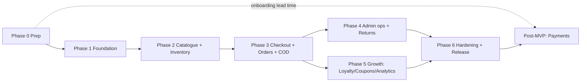

# SARUS Clothes — Implementation Plan

| Field | Value |
|---|---|
| Project | **SARUS Clothes** |
| Version / Status | 1.0 · Draft |
| Date | 29 October 2026 |
| Related | PRD.md §26–31, TRD.md, BACKEND_SCHEMA.md, APP_FLOW.md, UI_UX_DESIGN_BRIEF.md |

> Nothing in this plan has been executed. Durations are **not estimated** because team size and velocity are unknown; use the sequence, dependencies and Definition of Done. Platform-specific steps (Google AI Studio Build, Firebase, Cloud Run) must be verified against current documentation **[VERIFY]**.

---

## 1. How to Use These Documents with Google AI Studio Build

1. **Keep documents as the source of truth.** Store the six documents in the repo `/docs`.
2. **Prompt per phase, not all at once.** For each task below, give the build tool: (a) the relevant PRD sections, (b) the matching TRD/Schema sections, (c) the task's Definition of Done. Large single prompts produce inconsistent code.
3. **Order of work inside every phase:** shared types/schemas → server module + tests → rules/indexes → API → UI → e2e tests.
4. **Guardrails to repeat in every prompt:** brand name exactly "SARUS Clothes"; PKR integers; server-side pricing/stock/payments/loyalty; no client writes to privileged collections; no secrets in client; no fake data/buttons; payment providers `Not Configured`; honest notification states.
5. **Version control from day one.** Export/sync to Git after each task **[VERIFY AI Studio export options]**; review diffs; run CI.
6. **Feature flags** for incomplete features (`settings/store.flags`) so unfinished work never appears to users.

### 1.1 Reusable prompt skeleton
```
Project: SARUS Clothes (exact brand name). Stack: React+TS (Vite), Node+TS server, Firestore, Firebase Auth, Storage, Cloud Run.
Task: <task id and title>
Read: PRD §<x>, TRD §<y>, BACKEND_SCHEMA §<z>
Do: <specific deliverables>
Rules: server-side authority for price/stock/payment/loyalty; Zod validation; RBAC via central policy; integer PKR; Asia/Karachi display;
       no placeholder buttons; no invented provider APIs; add tests listed in DoD.
Output: code + tests + short notes of assumptions/manual steps.
```

---

## 2. Pre-Implementation Checklist (Phase 0)

| # | Task | Owner | Output |
|---|---|---|---|
| 0.1 | AI Studio capability spike: full-stack app, server runtime, env/secrets handling, Firebase connection, export to Git **[VERIFY]** | Tech lead | Decision note (A-08) |
| 0.2 | Create Firebase/GCP projects (dev, staging, prod) and enable billing where required | Owner/Tech | Project ids |
| 0.3 | Enable Firestore (region decision), Auth (Email/Password, Google optional), Storage | Tech | Configured services |
| 0.4 | Owner accounts (≥ 2 recommended) and recovery process | Owner | Emails |
| 0.5 | Gather business inputs: shipping zones/fees, return window, loyalty economics, COD policy, initial catalogue data, policies text | Owner | Input sheet (PRD §30.3) |
| 0.6 | Brand inputs: logo (or confirm placeholder), fonts, photography, domain | Owner | Asset register |
| 0.7 | Email provider selection and domain DNS access | Owner | Provider decision |
| 0.8 | Start JazzCash/Easypaisa merchant onboarding in parallel (long lead time) | Owner | Application status |
| 0.9 | Repo, CI skeleton, lint/format, commit conventions | Tech | Green CI |

---

## 3. Phase Plan

Each task lists: **ID — deliverable — refs — tests/DoD**.

### Phase 1 — Foundation, database, authentication and permissions
| ID | Deliverable | Refs | Tests / DoD |
|---|---|---|---|
| 1.1 | Monorepo skeleton (`apps/web`, `apps/server`, `packages/shared`), TS strict, ESLint/Prettier, Vitest, env loader with schema validation | TRD §3 | CI green; server boots with `/healthz` |
| 1.2 | Shared enums/types/Zod schemas (roles, statuses, money utils, phone/city validators) | Schema §3, §9 | Unit tests for phone formats, money rounding |
| 1.3 | Firebase Admin init, token verification middleware, request-id, error envelope, Pino logging with redaction | TRD §4, §7–8 | Integration tests with Auth emulator; no secret/PII in logs |
| 1.4 | RBAC policy table + `requirePermission`; route registry test that fails for routes lacking declarations | TRD §4.3, PRD §4 | Role × endpoint matrix test (TC-001) |
| 1.5 | `users`, `staff`, `settings`, `auditLogs`, `counters` collections + services; bootstrap Owner script (one-time, guarded) | Schema §4.1–4.3, 4.26, 4.34 | Last-owner invariant test; audit written |
| 1.6 | Auth flows UI: signup, login, verify email, reset, session sync | APP_FLOW §3.6 | e2e: signup→verify gate; no account enumeration |
| 1.7 | Firestore + Storage rules v1 + emulator tests (allow/deny matrix) | Schema §8 | Rules tests pass (TC-002) |
| 1.8 | Design tokens, base components (buttons, inputs, layout, toasts), a11y baseline | UI brief §2, §4 | axe clean on component stories |
| 1.9 | Security headers/CSP/CORS/rate-limit scaffolding (shared limiter store decision) | TRD §7–8 | Header tests |
**Phase DoD:** US-005, US-006, US-101 acceptance met; TC-001/002/021 pass; rules deployed to dev; docs updated.
**Manual/external:** Firebase config, authorised domains, Owner emails.

### Phase 2 — Storefront, product catalogue, seasonal collections and inventory
| ID | Deliverable | Refs | Tests / DoD |
|---|---|---|---|
| 2.1 | Collections: `categories`, `optionSets`, `collections`, registries (`skuRegistry`, `slugRegistry`) | Schema §4.6–4.9 | Uniqueness transaction tests |
| 2.2 | Products + variants services, validations, publish rules | PRD §9 | Unit + integration (TC-003 data side) |
| 2.3 | Inventory service (adjust, movements, invariants) + admin adjust API | TRD §6.3 | Invariant tests; idempotent adjust (TC-014/015 base) |
| 2.4 | Image upload (signed URLs), verification, derivatives | TRD §8, FR-029 | Upload constraints tests |
| 2.5 | Admin UI: categories, products/variants editor, images, SEO tab, inventory screens | APP_FLOW §4.2–4.3 | e2e admin create→publish product |
| 2.6 | Public catalogue API with filters/sort/pagination/search tokens, caching headers | TRD §6.9, §7 | Query/index tests; no cost/exact stock leakage |
| 2.7 | Storefront: Home (CMS-ready blocks static first), listing, collection pages, PDP, search, size guide | APP_FLOW §3.1–3.2 | Responsive & a11y checks; Lighthouse baseline recorded |
| 2.8 | SEO shell: meta, canonical, JSON-LD (Product/Breadcrumb), sitemap, robots, noindex headers | PRD §21 | TC-024 (partial) |
| 2.9 | Collection scheduling job + admin scheduling UI; archive behaviour | PRD §8 | TC-017, TC-023 |
| 2.10 | CSV export; import (validate→preview→confirm) | PRD §9.3 | TC-018 |
**Phase DoD:** catalogue managed end to end from admin; US-001–003, US-102–105 pass; concurrency test on adjust passes in emulator.
**Manual/external:** Storage bucket/rules deployment; sample catalogue data from owner.

### Phase 3 — Cart, checkout, orders, COD and payment architecture
| ID | Deliverable | Refs | Tests / DoD |
|---|---|---|---|
| 3.1 | Pricing engine (pure) + fixtures: sale windows, coupons placeholder hooks, shipping, rounding | PRD §16.3, TRD §6.2 | Fixture suite (TC-006 base) |
| 3.2 | Cart API (guest cookie + user), merge, warnings | PRD §11 | TC-005 (cart idempotency), merge tests |
| 3.3 | Shipping zones settings + estimate API; city list | PRD §14 | Validation tests |
| 3.4 | Checkout quote + order placement transaction with idempotency; reservation | TRD §6.4, Schema §7.1 | TC-004 (concurrency), TC-005, TC-006 |
| 3.5 | Order state machine, events, admin transition API | PRD §12.2, TRD §6.5 | TC-013 full matrix; TC-014/015 |
| 3.6 | Payment abstraction + COD provider + disabled JazzCash/Easypaisa stubs; payment status admin screen | TRD §6.6, FR-056/095 | TC-022; code scan: no guessed provider endpoints |
| 3.7 | Webhook ingestion skeleton against **mock provider** (signature scheme placeholder in test only), replay guard, mismatch handling | TRD §6.6, Schema §7.6 | TC-008/009 on mock |
| 3.8 | Storefront: cart, checkout (4 steps), confirmation, track order | APP_FLOW §3.3–3.8 | e2e guest COD; TC-010 base |
| 3.9 | Admin: order list/detail, status actions, COD collected, manual shipments | APP_FLOW §4.6–4.7 | e2e confirm→ship→deliver |
| 3.10 | Notifications outbox + template store + email adapter interface (provider optional); honest statuses | TRD §6.8 | TC-022; US-117 |
| 3.11 | Jobs: release reservations, dispatch notifications; scheduler wiring in staging | TRD §6.10 | Idempotency tests |
**Phase DoD:** COD order placed and fulfilled on staging with correct stock movements; no negative stock under load test; US-004, 007, 008, 011–013, 106–107, 118 pass.
**Manual/external:** email provider key & DNS (if enabling real emails now); shipping fee data.

### Phase 4 — Complete admin panel, settings, fulfilment, returns and customer management
| ID | Deliverable | Refs | Tests / DoD |
|---|---|---|---|
| 4.1 | Returns module (eligibility, request, decisions, receive/inspect, restock) | PRD §15, Schema §4.19 | TC-016 |
| 4.2 | Refunds module (create, approve, complete with provider/manual proof) | Schema §4.20 | TC-011 |
| 4.3 | Customer management, support notes, masked views | PRD §4 | Role tests; PII masking tests |
| 4.4 | Staff management: invite, role change, disable, revoke sessions; MFA enforcement where supported | TRD §4.5–4.6 | TC-021 |
| 4.5 | CMS: homepage blocks, banners (scheduled), pages, redirects | Schema §4.27 | Sanitisation tests (TC-019) |
| 4.6 | Settings screens: store, shipping, returns, loyalty (UI only if Phase 5 backend), payments status, analytics IDs | PRD §18 | Schema validation; secrets rejected |
| 4.7 | Audit log viewer, security events | PRD FR-092 | Diff display tests |
| 4.8 | Notification templates admin + outbox viewer + retry | PRD §20 | Retry tests |
| 4.9 | Customer account area: orders, returns, addresses, profile | APP_FLOW §3.7, 3.10 | e2e return request |
**Phase DoD:** every admin screen has a real backend operation; no mock data; US-013 (staff side), 014, 108–110, 113, 114, 116 pass.

### Phase 5 — Wishlist, loyalty, coupons, marketing, SEO and analytics
| ID | Deliverable | Refs | Tests / DoD |
|---|---|---|---|
| 5.1 | Wishlist API/UI | PRD §11.1 | US-015 |
| 5.2 | Coupons: admin CRUD, validation engine, transactional redemption; integrate with pricing | PRD §16 | TC-007 full edge suite |
| 5.3 | Seasonal promotions (collection/category sale windows) | FR-018 | Window/timezone tests |
| 5.4 | Loyalty: ledger, earn/release/redeem/reverse/expire jobs, admin settings and adjust, customer page | PRD §17, Schema §4.23–4.24 | TC-012; nightly verification job |
| 5.5 | Reviews (verified, moderated) + rating schema only when real | PRD FR-111 | US-018 |
| 5.6 | Newsletter consent, marketing preferences; abandoned-cart **design + disabled job** | PRD FR-106 | Consent log tests |
| 5.7 | Analytics: `analyticsDaily`, dashboard, reports, expenses, profit w/ cost-missing warnings, CSV export | PRD §19 | TC-023, TC-026 on fixtures |
| 5.8 | Consent banner + gated analytics scripts; SEO settings, redirects, sitemap refinements | PRD §19, §21 | Consent tests; TC-024 |
**Phase DoD:** formulas verified against fixture datasets; US-009, 010, 015, 016, 018, 111, 112, 115, 117 pass.
**Manual/external:** analytics property IDs; legal text for consent/marketing.

### Phase 6 — Security audit, integration verification, end-to-end tests, deployment and release preparation
| ID | Deliverable | Refs | Tests / DoD |
|---|---|---|---|
| 6.1 | Security review (authZ matrix, rules, headers, injection/XSS, upload, rate limits); fix findings | PRD §24 | No high/critical open |
| 6.2 | Dependency/secret scans; CSP tightening | SEC-006/022 | Clean reports |
| 6.3 | Full e2e (Playwright) incl. mobile viewport; a11y audit; performance budgets | PRD §25, §27 | Results recorded |
| 6.4 | Load/concurrency tests on staging (TC-004 at scale) | NFR-007 | No oversell |
| 6.5 | Backup schedule + restore drill | SEC-019 | TC-025 recorded |
| 6.6 | Monitoring/alerts/uptime; runbooks | TRD §10 | Alerts fire in test |
| 6.7 | Production project setup, secrets, Cloud Run deploy, scheduler jobs, domain + HTTPS | PRD §28 | Smoke tests |
| 6.8 | Data request workflow (export/delete) | SEC-020 | TC-027 |
| 6.9 | UAT with Owner and staff; policy pages finalised (legal reviewed) | PRD §30 | Sign-off |
| 6.10 | Release checklist & rollback plan | — | Signed |
**Phase DoD:** PRD §32 "before live launch" items all confirmed; TC-001–027 executed with recorded results.

### Post-MVP tracks (separate backlog)
| Track | Preconditions | Work |
|---|---|---|
| JazzCash live | Merchant approval, official docs, sandbox creds | Adapter per docs, sandbox test plan, reconciliation, go-live checklist |
| Easypaisa live | Same | Same |
| Courier integration | Chosen courier + API access | Adapter, tracking sync (real events only), COD remittance reconciliation |
| SMS/WhatsApp | Provider approvals/templates | Adapters, consent, delivery receipts |
| Abandoned-cart reminders | Email/SMS provider, consent, scheduler | Enable flag after testing |
| Urdu/RTL | Translations | i18n content, RTL QA |
| External search | Provider selection | Index sync, facet queries |

---

## 4. Dependency Graph (summary)

Phases 4 and 5 can overlap after Phase 3 if different people own them, but shared modules (pricing, orders) must be stable first.

---

## 5. Definition of Done (global)
A task is done only when all apply:
1. Code merged via reviewed PR; TypeScript strict passes; lint clean.
2. Unit/integration tests added and passing in CI (recorded, not assumed).
3. Rules/index changes included and rule tests pass.
4. Authorization declared for every new endpoint; matrix test updated.
5. Inputs validated with shared Zod schemas; outputs contain no secrets/cost/PII beyond need.
6. UI states complete (loading/empty/error/success), responsive (360/768/1024/1440), keyboard operable, axe clean.
7. Audit log entries for privileged writes.
8. Docs updated (assumptions, manual steps, changelog).
9. No placeholder buttons, mock numbers or simulated success remain.
10. Feature flag set correctly; unfinished features hidden.

---

## 6. Quality Gates per Environment
| Gate | Dev | Staging | Production |
|---|---|---|---|
| CI (lint, types, unit, rules, integration) | ✔ | ✔ | ✔ (release tag) |
| E2E suite | optional | ✔ | smoke only |
| Security scans | ✔ | ✔ | ✔ |
| Load/concurrency | — | ✔ | — |
| Restore drill | — | ✔ | documented |
| Manual UAT | — | ✔ | sign-off |
| Credentials | emulator/dev | sandbox only | live after approval |

---

## 7. Roles and Responsibilities (suggested)
| Role | Responsibility |
|---|---|
| Owner/Product | Decisions in PRD §30.3, content, approvals, merchant onboarding |
| Tech lead / full-stack | Architecture, security, reviews, AI Studio workflow |
| Front-end dev/designer | UI system, storefront, accessibility |
| QA | Test plans/execution, UAT coordination |
| Operations lead | Runbooks, fulfilment process, staff training |
(One person may hold several roles; AI assistants produce code but a human reviews security-critical modules: pricing, inventory, payments, authZ, rules.)

---

## 8. Risk Watchlist During Build
| Risk | Early signal | Response |
|---|---|---|
| AI-generated code trusts client values | Totals/prices accepted from request bodies | Reject in review; add forged-total test |
| Missing authZ on new route | Route registry test failing | Block merge |
| Overselling | Concurrency test flaky | Stop feature work; fix transaction logic |
| Scope creep to online payments | Hard-coded gateway endpoints appear | Revert; follow INT checklist |
| AI Studio limits | Cannot run server/secrets | Move to local/Git + Cloud Run workflow |
| Fake data in UI | Hard-coded KPIs/charts | Replace with real queries or remove |

---

## 9. Launch Readiness Summary
Launch only when: Phase 6 DoD met; policies approved; domain/HTTPS active; email domain authenticated; backup/restore drill done; staff trained; payments remain `Not Configured` unless separately approved and tested; Owner signs the release checklist.

*End of Implementation Plan.*
