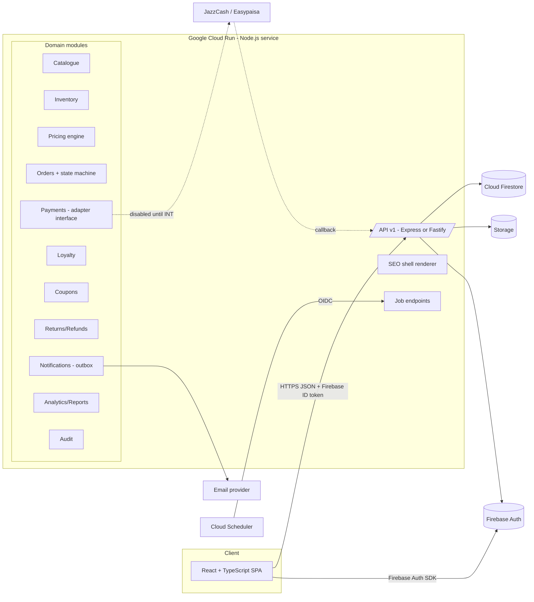

# SARUS Clothes — Technical Requirements Document (TRD)

| Field | Value |
|---|---|
| Project | **SARUS Clothes** |
| Version / Status | 1.0 · Draft |
| Date | 29 October 2026 |
| Parent document | PRD.md (requirement IDs referenced throughout) |
| Normative for | Runtime architecture, server behaviour, security controls, infrastructure |

> Platform capabilities (Google AI Studio Build, Firebase, Cloud Run) change. Every item marked **[VERIFY]** must be checked against current official documentation before implementation. Nothing here claims that anything has been built or deployed.

---

## 1. Architecture Overview

### 1.1 Style
Single deployable **Node.js (TypeScript) server** that (a) serves the built React SPA, (b) exposes a versioned JSON API (`/api/v1`), (c) performs server-side HTML shell injection for SEO (meta tags, JSON-LD) on public routes, and (d) hosts job endpoints invoked by Cloud Scheduler. Data lives in Cloud Firestore; identity in Firebase Authentication; files in Cloud/Firebase Storage. A modular monolith is chosen for MVP simplicity; modules have strict boundaries so they can be split later.

### 1.2 Logical diagram


### 1.3 Responsibilities
| Layer | Does | Must not |
|---|---|---|
| React SPA | Rendering, UX state, form validation (UX only), Firebase Auth sign-in | Decide prices/stock/payment/loyalty; hold secrets |
| API | AuthN/Z, validation, business rules, transactions, integrations | Trust client-submitted totals, roles or ids |
| Firestore | Authoritative data | Be written directly by clients for privileged data |
| Storage | Images/exports | Serve private files publicly |
| Jobs | Scheduled maintenance | Be callable by users |

### 1.4 Platform assumptions **[VERIFY]**
- AI Studio Build can generate/run a full-stack TypeScript app (React front end + Node server) and export to GitHub/zip. Server-side secrets handling and Firebase integration options in AI Studio must be confirmed; if limited, develop locally from the exported repo and deploy via Cloud Run.
- Cloud Run supports container deploys of Node services, custom domains (mapping or load balancer), Secret Manager mounts, and Scheduler OIDC invocation.
- Firestore transactions: reads must precede writes; limits on writes per transaction and contention behaviour apply **[VERIFY current limits]**.

---

## 2. Technology Stack

| Concern | Choice | Notes |
|---|---|---|
| Language | TypeScript (strict) everywhere | Shared types package for DTOs |
| Frontend | React 18+, Vite, React Router, TanStack Query, Zustand (UI state only), React Hook Form + Zod | Tailwind CSS with design tokens (UI brief) |
| Backend | Node.js LTS, Express (or Fastify), Zod validation, `firebase-admin` | Pino JSON logging |
| Database | Cloud Firestore (Native) | See BACKEND_SCHEMA.md |
| Auth | Firebase Authentication (+ optional Identity Platform for MFA) | Server verifies ID tokens |
| Storage | Firebase/Cloud Storage | Signed URLs; derivative generation with `sharp` |
| Email | Provider adapter (provider TBD) | INT-003 |
| Hosting | Cloud Run (container) | Cloud Build / GitHub Actions |
| Scheduling | Cloud Scheduler | OIDC-authenticated |
| Secrets | Secret Manager | Env var injection |
| Testing | Vitest, Supertest, Firebase Emulator Suite, Playwright, axe, k6 | PRD §27 |
| Lint/format | ESLint, Prettier, `tsc --noEmit` in CI | |

---

## 3. Repository and Module Layout

```
/sarus-clothes
  /apps
    /web            # React SPA (storefront + admin routes, code-split)
    /server         # Node API, jobs, SEO shell
  /packages
    /shared         # Zod schemas, DTO types, enums (OrderStatus, Roles…), money utils
    /config         # eslint/tsconfig bases
  /firebase
    firestore.rules
    firestore.indexes.json
    storage.rules
    /tests          # rules tests
  /scripts          # migrations, seed (non-production demo data flagged), rebuild jobs
  /docs             # PRD, TRD, etc.
  Dockerfile
```

Server modules (`apps/server/src/modules/*`): `auth`, `rbac`, `catalog`, `inventory`, `pricing`, `cart`, `checkout`, `orders`, `payments` (`providers/jazzcash`, `providers/easypaisa`, `providers/cod`), `shipping`, `returns`, `refunds`, `coupons`, `loyalty`, `reviews`, `content`, `settings`, `analytics`, `reports`, `notifications` (`providers/email`), `seo`, `audit`, `jobs`, `uploads`. Each module exposes a service interface; route handlers contain no business logic.

---

## 4. Authentication and Authorization

### 4.1 Identity flow
1. Client signs in via Firebase Auth SDK; obtains ID token.
2. Client sends `Authorization: Bearer <idToken>`.
3. Server middleware `requireAuth` → `admin.auth().verifyIdToken(token, checkRevoked?)`. Staff routes use `checkRevoked=true`.
4. `requireVerifiedEmail` for registered checkout and account-mutating routes.
5. `requireStaff(permission)` loads `staff/{uid}` (in-memory cache ≤ 60 s), checks `status=active`, resolves role → permission set from the central policy table.

### 4.2 Roles and custom claims
Role set: `owner, admin, product_manager, order_manager, content_editor, support, analyst`. Custom claim `{ role }` is set by the server on staff creation/change and mirrored in `staff/{uid}`; **the Firestore record is authoritative**; claims are a cache for rules and fast checks. Role change → `revokeRefreshTokens(uid)` and audit entry. A claim never grants more than the record.

### 4.3 Permission policy table (excerpt)
Defined in `shared/permissions.ts` as `resource:action` strings, e.g. `orders:transition`, `orders:read`, `products:write`, `inventory:adjust`, `refunds:approve`, `loyalty:adjust`, `staff:manage`, `settings:payments`. Roles map to sets mirroring PRD §4. A unit test asserts the full matrix (TC-001). Handlers declare `requirePermission('orders:transition')`; there is no handler without an explicit declaration (lint rule / route registry test fails otherwise).

### 4.4 Guests
No Firebase account. Guest cart via opaque `cartId` cookie (HttpOnly, Secure, SameSite=Lax, 30-day max-age). Guest order tracking uses order number + phone/email match, rate-limited.

### 4.5 Admin sessions (recommended)
Admin SPA may exchange the ID token for a **server session cookie** (`createSessionCookie`, 5 min–14 day configurable; default 8 h for staff **[TBD]**), with CSRF double-submit token on mutating requests. If bearer tokens are used instead, tokens stay in memory only (never localStorage).

### 4.6 MFA
Owner/Admin MFA required where Firebase/Identity Platform supports it **[VERIFY]**; otherwise enforced by policy and documented manual setup. Server may check `firebase.sign_in_second_factor` claim for Owner/Admin routes once enabled.

---

## 5. Firestore Access Strategy

| Principle | Implementation |
|---|---|
| Default deny | `allow read, write: if false;` at root |
| Public reads | Only `products` (status=active), `categories`, `collections` (published), `banners`, `pages`, `homepage`, `settings/public`; **variants expose non-sensitive fields only** — to avoid leaking exact stock/cost, public catalogue reads go through the API, so rules deny public reads of `variants` and rely on API; the client SDK is **not** used for catalogue in MVP |
| Customer reads | `users/{uid}`, `users/{uid}/addresses`, `wishlists/{uid}`, `orders` where `userId == request.auth.uid`, `loyalty*` for own uid, `returns` own |
| Client writes | None (all writes via API) |
| Staff | Staff use API only; rules do not grant staff client-side writes |
| Server | Admin SDK bypasses rules → authZ in code (SEC-002) |

Rules are covered by emulator tests asserting both allow and deny (TC-002). Storage rules: public read only for `public/products/**` and `public/banners/**` derivatives; `private/returns/**`, `private/exports/**`, `private/imports/**` denied to clients (server-signed URLs only).

---

## 6. Core Domain Algorithms

### 6.1 Money
Integer PKR. Helper `Money` utilities in `shared`. No floating point; percentages use `Math.floor(amount * pct / 100)` with integer math. Formatting `Rs 1,500` via `Intl.NumberFormat('en-PK')`.

### 6.2 Pricing engine (`pricing.compute(input)`)
Pure function (no I/O) fed with prefetched documents: cart lines, variants, products, active promotions, coupon, zone, loyalty rules, server `now`. Implements PRD §16.3 order. Outputs line breakdowns, totals, warnings, `pricingVersion` (semantic version string of the algorithm) and `pricingHash` (SHA-256 of normalised inputs+outputs). Used by `/checkout/quote` and again inside the order transaction (re-fetch within the transaction for variants/coupons so values cannot drift).

### 6.3 Inventory service
- `reserve(orderId, lines)`, `release(orderId, reason)`, `fulfil(orderId)`, `restock(returnId, items)`, `adjust(actor, variantId, type, qty, reason)`.
- Each operation: Firestore transaction → read variant docs (and existing movement doc by deterministic id) → if movement exists return (idempotent) → validate invariants (`onHand ≥ 0`, `reserved ≥ 0`, `reserved ≤ onHand`, `available ≥ qty` for reserve) → write new variant values and movement doc `{movementId}`.
- Movement ids: `{type}_{orderId|returnId|adjustmentId}_{variantId}`; for manual adjustments, client-supplied `Idempotency-Key` hashed.
- Contention: hot variants may cause retries; transaction retried (max 5, jittered backoff); on exhaustion return `409 TRY_AGAIN` (not oversell).
- Large orders: ≤ 20 distinct variants per order keeps within transaction write budget **[VERIFY limits]**; enforce `maxLinesPerOrder` = 20 **[ASSUMPTION]**.

### 6.4 Checkout transaction (outline)
```
POST /checkout/orders  (Idempotency-Key required)
1. Validate input (Zod), rate limit, auth rules (registered ⇒ verified email).
2. Idempotency lookup idempotencyKeys/{hash(scope,key)}: same key+same body → return stored result; same key+different body → 409 IDEMPOTENCY_MISMATCH.
3. Run transaction:
   a. read: settings/store, shipping zone, variants (by id), products (for snapshots), coupon + registry + user redemption counts, loyalty account
   b. recompute pricing with in-transaction data; compare to optional client pricingHash → note mismatch
   c. validate stock; for each line: reserved += qty
   d. write: orders/{id}, orders/{id}/items/*, orders/{id}/events/placed, payments/{id}(cod_awaiting), inventoryMovements/*, couponRedemptions/{orderId_couponId} + coupon.usageCount, loyaltyLedger redeem row + account balance, idempotencyKeys/{hash}={orderId}
4. After commit (outside transaction): clear cart, enqueue notification outbox, write audit/system log.
```
If step 4 fails, the order stands; compensating retries are idempotent.

### 6.5 Order state machine
Implemented as a transition table in `shared/orderMachine.ts` `{from → [{to, permission, requires, effects[]}]}`. `orders.transition(orderId, to, actor, data, expectedVersion)` runs a transaction: read order → verify `version` → check allowed transition and permission → execute effects (inventory, payment, loyalty, shipment) → increment version → append event. Effects idempotent via deterministic ids. Illegal → `409 INVALID_TRANSITION`.

### 6.6 Payments abstraction
```ts
interface PaymentProvider {
  id: 'cod' | 'jazzcash' | 'easypaisa';
  status(): 'not_configured' | 'sandbox' | 'live' | 'error';
  createPayment(order: OrderRef): Promise<PaymentIntentResult>;        // not implemented until INT onboarding
  verifyCallback(req: RawRequest): Promise<VerifiedPaymentEvent>;      // signature per official docs
  queryStatus(paymentId: string): Promise<ProviderStatus>;
  refund(req: RefundRequest): Promise<RefundResult>;                   // only if provider supports
}
```
- `cod` is fully implemented. `jazzcash` and `easypaisa` ship as stubs returning `NOT_CONFIGURED` and **contain no guessed endpoints, field names or hashing schemes**. Real implementation requires official docs, credentials and sandbox (INT-001/002).
- Payment status transitions: `initiated → pending → verified|failed|expired`; verified only by `verifyCallback`/`queryStatus` success with amount, currency PKR and merchant reference matching the stored intent.
- `paymentEvents/{eventKey}` created with `create()` (fails if exists) before processing ⇒ replay protection; processing is idempotent.

### 6.7 Loyalty service
- `earnPending(orderId)` on `delivered`, `releaseEarn(orderId)` after window (job), `redeem(orderId, points)`, `reverseRedeem`, `reverseEarn(returnId)`, `expire(uid)`, `adjust(actor, uid, delta, reason)`.
- Ledger id deterministic; transaction updates `loyaltyAccounts/{uid}` with balances; invariant check `balance = Σ ledger` in nightly verification job (alerts on drift; account rebuildable).

### 6.8 Notifications
Outbox pattern: domain events insert `notificationOutbox` (status `queued`). Worker job (`/jobs/dispatch-notifications`, every minute) claims batch via transaction (status → `sending`, lease), renders template, calls provider adapter, sets `sent` with `providerMessageId` only on provider success; `failed` after N attempts. If provider not configured, status `not_configured` (not `sent`).

### 6.9 Search (MVP)
Firestore cannot do full-text search. MVP: maintain `searchTokens[]` (lower-cased name tokens + prefixes + SKU + category/tag words) on products; query using `array-contains-any` (limited) with server-side ranking. Known limits: typo tolerance and relevance quality. INT-007 (Algolia/Typesense/Meilisearch/Vertex AI Search) is the planned upgrade **[VERIFY options]**.

### 6.10 Scheduled jobs
| Job | Frequency | Behaviour |
|---|---|---|
| `publish-collections` | every 5 min | `scheduled`→`published`, `published`→`expired` by time |
| `release-reservations` | every 5 min | Expire unpaid online-payment reservations (no-op while online payments disabled) |
| `release-loyalty-pending` | hourly | Convert pending points after return window |
| `expire-points` | daily 02:00 PKT | Create `expire` rows |
| `rebuild-analytics` | hourly (today) + daily (yesterday) | Fill `analyticsDaily` |
| `dispatch-notifications` | every minute | Outbox worker |
| `low-stock-scan` | daily | Safety net for threshold alerts |
| `ledger-verify` | daily | Loyalty/stock invariant checks, alerts |
| `cleanup` | daily | TTL deletions for idempotency, carts, outbox beyond retention |

All jobs authenticate via Scheduler's OIDC token (audience = service URL, caller service account allow-listed), are idempotent, and write run summaries to logs.

---

## 7. API Technical Conventions

- Base `/api/v1`; JSON only; `Content-Type: application/json` enforced; max body 1 MB (uploads use signed URLs).
- Request ID: `x-request-id` accepted/generated, echoed in responses and logs.
- Validation: Zod schemas shared with client; unknown keys rejected (`.strict()`).
- Pagination: cursor-based (`limit` ≤ 100, `cursor`); listing endpoints return `{ items, nextCursor, total? }` (`total` only where cheap/aggregated; Firestore `count()` aggregation where needed).
- Concurrency: mutable admin resources carry `version`; `If-Match`/body `version`; mismatch → `409 CONFLICT`.
- Idempotency: `Idempotency-Key` header (8–64 chars) required on `POST /checkout/orders`, refunds, loyalty adjustments, inventory adjustments, returns create.
- Errors per PRD §23 envelope; error mapping layer converts internal errors to safe messages.
- Caching: public catalogue responses `Cache-Control: public, max-age=60, stale-while-revalidate=300` (CDN optional); private/user/admin responses `no-store`.
- Rate limiting: sliding-window limiter keyed by IP (+uid when authenticated). Instance-local in-memory limiting is **insufficient** across Cloud Run instances; use a shared store (e.g., Memorystore/Redis **[VERIFY cost/availability]**) or Firestore-based counters for low-volume endpoints, plus Cloud Armor for IP-level protection. Proposed limits: track-order 5/min/IP; coupon validate 10/min/user-or-IP; checkout 10/min/IP; auth-adjacent (session sync) 30/min/IP; suggest 60/min/IP; data-requests 1/24 h/user.

---

## 8. Security Technical Controls

| Control | Specification |
|---|---|
| Headers | `Content-Security-Policy` (default-src 'self'; script-src 'self' + nonce for inline; img-src 'self' data: storage domain; connect-src 'self' Firebase endpoints; frame-ancestors 'none'), `Strict-Transport-Security`, `X-Content-Type-Options: nosniff`, `Referrer-Policy: strict-origin-when-cross-origin`, `Permissions-Policy` minimal; Helmet middleware. Analytics scripts added to CSP only when configured. |
| CORS | Allow-list from `ALLOWED_ORIGINS`; credentials only for same-site admin |
| CSRF | Required for cookie-authenticated mutations |
| XSS | React escaping; rich text sanitised server-side with allow-list (e.g., `sanitize-html`/DOMPurify on server); no `dangerouslySetInnerHTML` without sanitised content |
| Injection | No dynamic collection paths from user input; IDs validated by regex; CSV cell formula-injection neutralised on export (prefix `'` for cells starting with `= + - @`) |
| Uploads | Signed upload URLs scoped to path/content-type/size; post-upload server verification (magic bytes, dimensions, re-encode); EXIF stripped |
| Secrets | Secret Manager; no secrets in repo, client bundle or logs; log redaction list (`authorization`, `cookie`, `idToken`, `apiKey`, card-like patterns) |
| Dependency | Lockfile, `npm audit` gate, Dependabot/Renovate, SBOM optional |
| Webhooks | Raw-body capture for signature checks; constant-time compare; timestamp tolerance if provider specifies |
| PII | Minimise fields; mask in logs (phone last 3 digits only); admin export masking by default |
| Backups | See §10 |

---

## 9. Performance and Scalability Design

- Cloud Run: concurrency 80 default **[tune]**; min instances 0 (staging) / 1 (prod, to avoid cold start on checkout) **[cost decision TBD]**; CPU boost; request timeout 60 s.
- Firestore: avoid sequential ids; sharded counters if any aggregate counter exceeds ~1 write/s sustained (e.g., coupon usage on viral coupons); precomputed `analyticsDaily`; composite indexes defined up front.
- Catalogue: server-side in-memory LRU (per instance) + HTTP caching; invalidate on product publish via short TTL (60 s) — acceptable staleness documented; **stock and price always authoritative at cart/checkout**.
- Images: WebP/AVIF derivatives at 320/640/960/1440 widths; `srcset`; lazy-load below fold; hero preloaded.
- Front end: route-level code splitting (admin separate chunk), font subsetting, `font-display: swap`.
- Load test plan (staging): catalogue read RPS, checkout concurrency, stock hot-spot (TC-004).

---

## 10. Reliability, Backup, Observability

- **Logging:** Pino JSON → Cloud Logging; fields: `requestId, uid(hash), role, route, status, latencyMs, errorCode`.
- **Error reporting:** Cloud Error Reporting (server) + front-end error capture (privacy-reviewed).
- **Uptime checks:** `/healthz` (liveness), `/readyz` (Firestore reachability check).
- **Alerts:** 5xx > threshold, p95 latency, job failure, outbox `failed` growth, payment mismatch count > 0, ledger drift > 0, budget thresholds.
- **Backups:** scheduled Firestore managed exports (daily) to a separate-region bucket with retention [TBD]; PITR if enabled **[VERIFY availability/cost]**; Storage versioning for product images optional. **Restore drill** in staging before launch; runbook includes steps to restore into a new database and cut over.
- **Failure modes:** notification provider down → outbox retries; Firestore transient errors → retry with backoff; payment provider timeouts → remain `pending`, reconcile job.

---

## 11. Environments and Configuration

| Env | Project | Credentials | Data |
|---|---|---|---|
| local | emulators | none | seed demo data (clearly labelled demo, never mixed to prod) |
| staging | `sarus-staging` | sandbox provider keys only | synthetic/test data |
| production | `sarus-prod` | live keys post-approval | real |

Config precedence: environment variables → Secret Manager → `settings/*` documents (non-secret business config only). Feature flags in `settings/store.flags` (e.g. `onlinePaymentsEnabled=false`, `reviewsEnabled`, `loyaltyEnabled`, `abandonedCartEnabled=false`). Flags are checked server-side; UI follows server.

CI/CD: PR → lint, typecheck, unit, rules tests, integration (emulators), build; main → deploy staging; tagged release + manual approval → deploy production; Firestore rules/indexes deployed with the release; rollback = previous Cloud Run revision.

---

## 12. Data Migration and Evolution
`schemaVersion` on documents; migrations in `/scripts/migrations/NNN_name.ts` with `--dry-run`, batch size, resumable cursor, logging; always preceded by backup export; compatible reads for N−1.

---

## 13. Technical Acceptance Checklist

| # | Condition | Linked |
|---|---|---|
| 1 | Every API route declares auth and permission; registry test enforces | SEC-002, TC-001 |
| 2 | No client writes possible to privileged collections (rules tests) | SEC-003, TC-002 |
| 3 | Checkout transaction idempotent and oversell-proof in concurrency test | FR-048/049, TC-004/005 |
| 4 | Pricing engine passes fixture suite incl. coupon edge cases | FR-047, TC-006/007 |
| 5 | Order state machine table-tested for all (from,to) pairs | §12.2, TC-013 |
| 6 | Payment adapters for JazzCash/Easypaisa return `NOT_CONFIGURED`; no guessed endpoints in code | FR-056/057, TC-022 |
| 7 | Webhook endpoint rejects unsigned/replayed/mismatched events (mock provider) | FR-059/060, TC-008 |
| 8 | Security headers/CSP verified | SEC-015 |
| 9 | Logs contain no secrets/PII beyond masks | SEC-006 |
| 10 | Backup restore drill documented and executed | SEC-019, TC-025 |
| 11 | SEO shell returns meta/JSON-LD in initial HTML for PDP/collection | NFR-014, TC-024 |
| 12 | Jobs reject non-Scheduler callers | §6.10 |

*End of TRD.*
